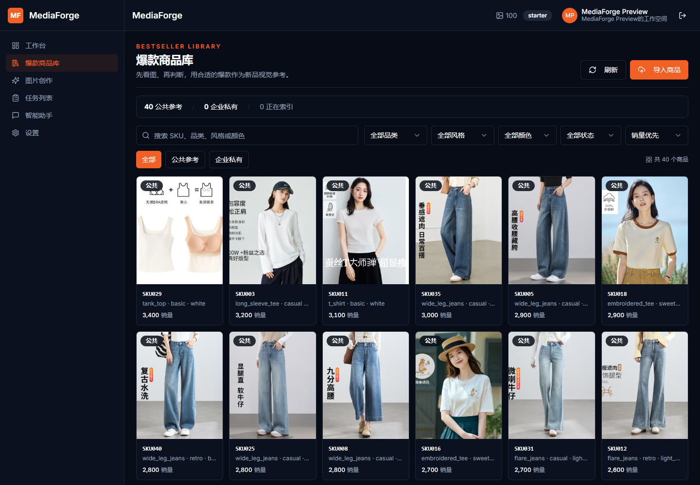
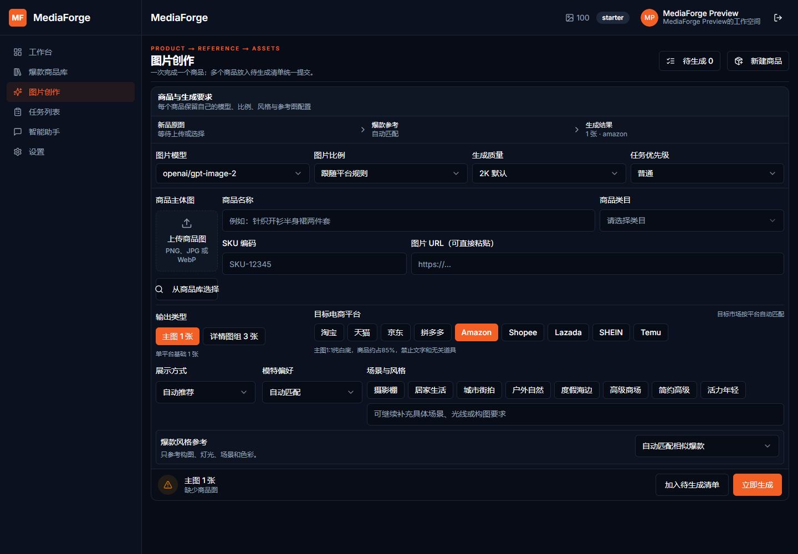
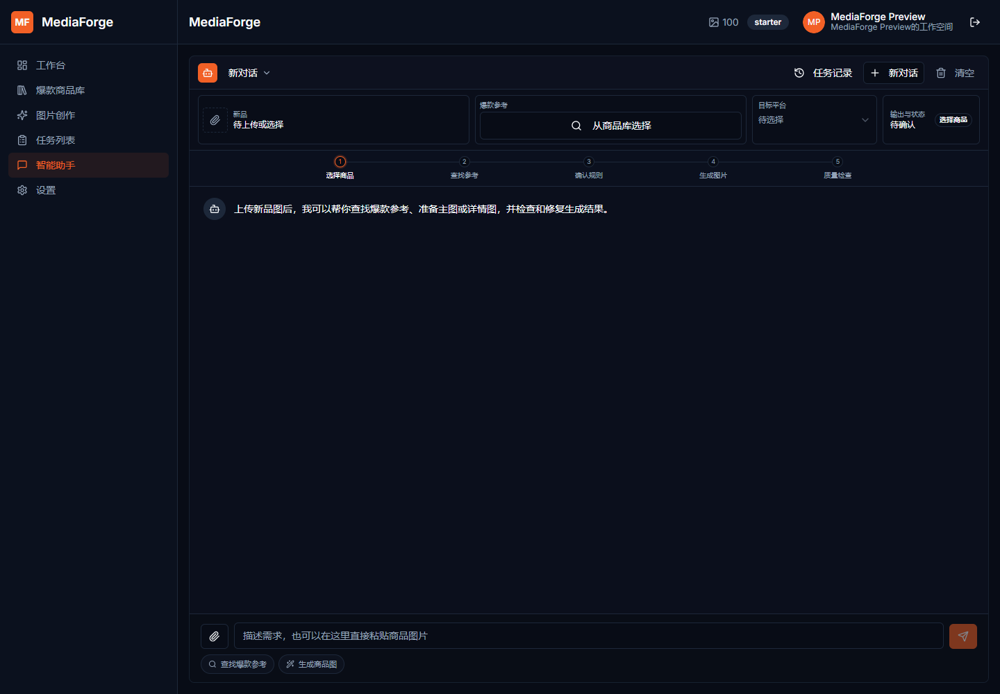
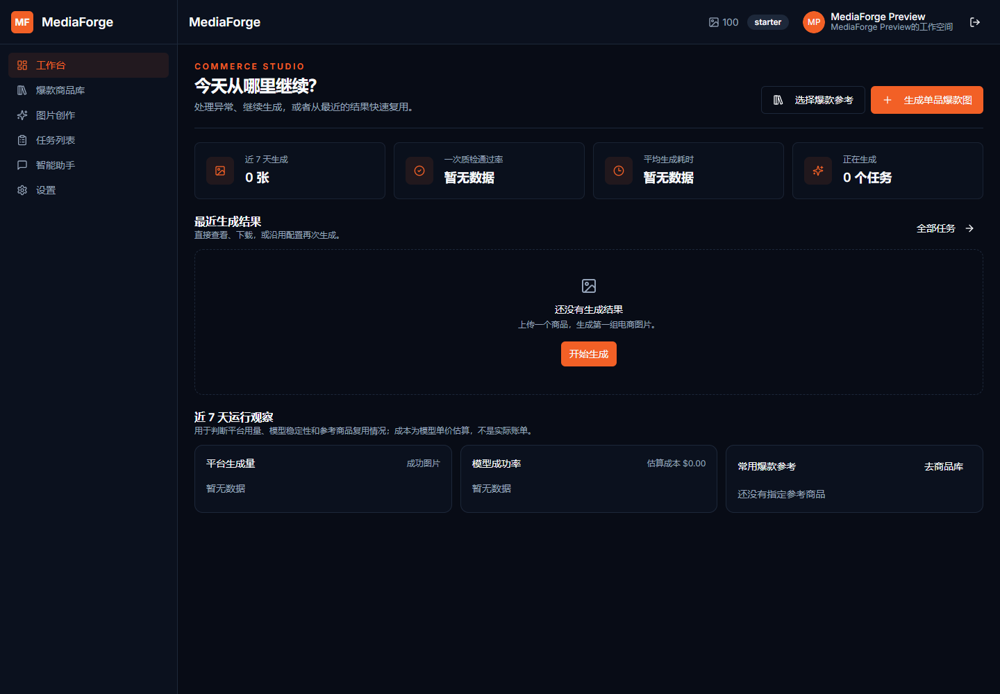
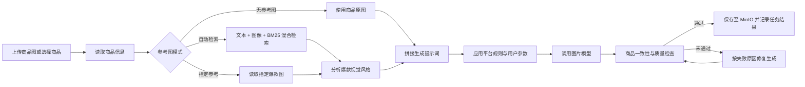
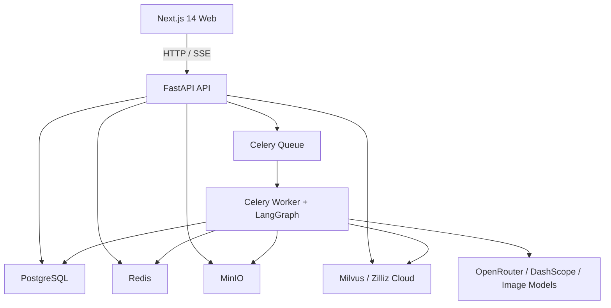

# MediaForge

> 面向电商运营团队的 AI 商品图片创作与爆款参考检索平台。

[](https://www.python.org/)
[](https://fastapi.tiangolo.com/)
[](https://nextjs.org/)
[](https://langchain-ai.github.io/langgraph/)
[](LICENSE)

MediaForge 将商品原图、爆款参考检索、电商平台图片规则、提示词生成、多模型图片生成和质量检查整合为一套可追踪的异步工作流。项目提供商品库、图片创作、任务中心、工作台和电商创意助手，适合用于搭建企业内部的电商视觉内容生产工具。

> [!IMPORTANT]
> 项目当前处于早期开发阶段，API、数据库结构和生成流程仍可能调整。图片与大模型调用依赖第三方服务，并可能产生费用。

## 界面预览

### 爆款商品库



### 图片创作



### 电商创意助手



### 工作台



## 核心功能

### 商品库

- 通过 CSV 或 Excel 批量导入商品资料与图片。
- 商品元数据保存至 PostgreSQL，图片保存至 MinIO。
- 文本向量、图像向量与稀疏检索数据写入 Milvus / Zilliz Cloud。
- 支持公共爆款参考商品和租户私有商品。

### 爆款参考检索

- 文本稠密向量检索。
- 图像稠密向量检索。
- Milvus BM25 稀疏关键词检索。
- 通过 RRF 融合并重排多路结果，为新品选择风格参考图。

### 商品图片创作

- 支持上传新品图或从商品库选择商品。
- 支持自动检索、指定爆款参考图和无参考图三种模式。
- 支持主图、详情页组图和拼多多白底图。
- 支持图片模型、尺寸、宽高比、优先级和自定义风格设置。
- 服装商品支持模特上身、纯商品展示和模特偏好设置。
- 根据目标平台自动拼接图片规则并执行生成质量检查。

### 异步任务与质量检查

- Celery 处理耗时的批量图片生成任务。
- LangGraph 编排校验、检索、生成、质量检查、修复和持久化流程。
- 任务中心展示原图、参考图、提示词、模型、生成结果和失败原因。
- 支持 SSE 实时任务进度和失败结果追踪。

### 电商创意助手

- 通过自然语言检索爆款商品。
- 对上传图片或商品库商品执行参考检索。
- 配置平台、输出类型、图片模型和生成参数。
- 提交任务前提供确认卡片，确认后创建持久化任务。
- 查询生成进度、结果和失败原因。
- 会话与上下文保存至 PostgreSQL。

## 支持的平台

当前内置以下平台的主图和详情图提示规则：

| 平台类型 | 已支持平台 |
| --- | --- |
| 国内平台 | 淘宝、天猫、京东、拼多多 |
| 跨境平台 | Amazon、Shopee、Lazada、SHEIN、Temu |

平台规则用于生成提示和质量检查，不代表平台官方审核结果。实际发布前请以对应平台最新规则为准。

## 工作流程



## 系统架构



## 技术栈

| 层级 | 技术 |
| --- | --- |
| 前端 | Next.js 14、React 18、TypeScript、Tailwind CSS、shadcn/ui、Zustand |
| API | FastAPI、Pydantic v2、SQLAlchemy 2.0 Async |
| 工作流 | LangGraph、LangChain、Celery |
| 数据库 | PostgreSQL 16、Alembic |
| 缓存与队列 | Redis 7 |
| 向量检索 | Milvus / Zilliz Cloud |
| 对象存储 | MinIO（S3 API） |
| Embedding | DashScope 文本与多模态 Embedding |
| 模型网关 | OpenRouter |
| 可观测性 | Loguru、LangSmith（可选） |

## 快速开始

推荐使用 Docker Compose 启动完整服务。首次启动会自动构建前后端、创建 MinIO Bucket，并执行 Alembic 数据库迁移。

### 环境要求

- Docker Engine 24+
- Docker Compose v2
- OpenRouter API Key
- DashScope API Key

### 1. 获取代码并配置环境变量

```bash
git clone https://github.com/arjun-go-go/mediaforge.git
cd mediaforge
cp .env.example .env
```

编辑 `.env`，至少需要设置：

```dotenv
OPENROUTER_API_KEY=sk-or-...
DASHSCOPE_API_KEY=sk-...
JWT_SECRET=replace-with-a-random-secret

POSTGRES_PASSWORD=replace-with-a-strong-password
MINIO_PUBLIC_BASE_URL=/api/v1/files
MINIO_ACCESS_KEY=minioadmin
MINIO_SECRET_KEY=replace-with-a-strong-password
```

MinIO Bucket 默认保持私有。浏览器通过 `MINIO_PUBLIC_BASE_URL=/api/v1/files` 指向的登录态接口读取图片，不需要公开 MinIO 的对象下载权限。

> [!WARNING]
> 示例中的 MinIO 账号密码只适合本地体验。生产环境必须更换 JWT Secret、MinIO 密码和数据库密码，并通过 HTTPS 暴露服务。

### 2. 选择向量数据库

#### 方案 A：Zilliz Cloud

在 `.env` 中填写 Zilliz Cloud 地址与 Token：

```dotenv
MILVUS_URI=https://your-cluster-endpoint
MILVUS_TOKEN=your-zilliz-cloud-token
MILVUS_DB_NAME=default
MILVUS_COLLECTION=mediaforge
```

Zilliz Cloud 模式不启动本地 Milvus 和 etcd：

```bash
docker compose up -d --build
```

#### 方案 B：本地 Milvus

在 `.env` 中使用 Compose 内部服务地址：

```dotenv
MILVUS_URI=http://milvus:19530
MILVUS_TOKEN=
MILVUS_DB_NAME=default
MILVUS_COLLECTION=mediaforge
```

启用 `local-milvus` profile，一次启动完整服务：

```bash
docker compose --profile local-milvus up -d --build
```

本地 Milvus 模式会额外启动 `milvus` 和它的元数据依赖 `etcd`。MinIO 同时负责 MediaForge 图片文件和 Milvus 对象数据。

### 3. 检查服务

```bash
docker compose ps
docker compose logs -f api celery-worker frontend
```

正常启动后访问：

- Web：<http://localhost:3100>
- OpenAPI：<http://localhost:8100/docs>
- API 健康检查：<http://localhost:8100/health>
- API 就绪检查：<http://localhost:8100/ready>
- MinIO Console：<http://localhost:9001>

`migrate` 容器执行完数据库迁移后显示 `Exited (0)` 属于正常状态。公开注册默认关闭，请先创建管理员账号：

```bash
docker compose run --rm \
  -e SEED_USER_EMAIL=admin@example.com \
  -e SEED_USER_PASSWORD='replace-with-a-strong-password' \
  api python scripts/seed_users.py
```

如仅用于本地演示并确实需要注册页面，可在 `.env` 中设置 `ALLOW_SELF_SIGNUP=true` 后重启 API。

### 4. 常用运维命令

```bash
# 查看全部日志
docker compose logs -f

# 查看指定服务日志
docker compose logs -f api
docker compose logs -f celery-worker
docker compose logs -f frontend

# 重启应用服务
docker compose restart api celery-worker celery-beat frontend

# 停止服务但保留数据
docker compose down

# 拉取代码更新后重新构建
docker compose up -d --build
```

本地 Milvus 模式执行运维命令时，需要继续带上 profile：

```bash
docker compose --profile local-milvus up -d --build
docker compose --profile local-milvus down
```

如需同时删除 PostgreSQL、MinIO、Milvus 和 etcd 的本地数据卷，可执行：

```bash
docker compose --profile local-milvus down -v
```

> [!CAUTION]
> `down -v` 会永久删除 Compose 管理的数据卷，仅可用于确定不再需要数据的开发环境。

### 5. Docker 服务说明

| 服务 | 作用 | 默认端口 |
| --- | --- | --- |
| `frontend` | Next.js Web | `3100` |
| `api` | FastAPI / OpenAPI | `8100` |
| `celery-worker` | 异步图片生成任务 | 无公开端口 |
| `celery-beat` | 定时任务调度 | 无公开端口 |
| `migrate` | 启动前执行 Alembic 迁移 | 一次性容器 |
| `postgres` | 业务数据与会话状态 | `5432` |
| `redis` | 缓存与 SSE 状态 | `6379` |
| `redis-broker` | Celery Broker | `6380` |
| `minio` | 商品图与生成素材 | `9000` / `9001` |
| `milvus` | 本地向量检索，可选 | `19530` / `9091` |
| `etcd` | Milvus 元数据，可选 | 不公开 |

## 本地开发（应用不运行在 Docker 中）

本地开发可以只用 Docker 启动基础设施，再直接运行前后端源码：

```bash
docker compose up -d postgres redis redis-broker minio minio-init etcd milvus
uv sync --frozen
uv run alembic upgrade head
```

随后分别启动应用进程：

```bash
# API
uv run uvicorn mediaforge.gateway.main:app --reload --port 8100
```

```bash
# Celery Worker
uv run celery -A mediaforge.celery_app worker -Q high,normal,low -l info
```

Windows 本地开发需要在 Worker 命令中增加 `--pool=solo`。

```bash
# Celery Beat
uv run celery -A mediaforge.celery_app beat -l info
```

```bash
# Web
cd frontend
npm ci
npm run dev
```

非 Docker 应用进程使用 `localhost` 连接 PostgreSQL、Redis、MinIO 和 Milvus；不要使用 `postgres`、`redis`、`minio`、`milvus` 等 Compose 内部主机名。

## 导入爆款商品数据

商品库页面提供 CSV 和 Excel 模板。也可以通过脚本导入：

```bash
uv run python scripts/seed_rag.py \
  --file data/products.csv \
  --image-dir images
```

导入流程会将商品信息写入 PostgreSQL，将图片上传至 MinIO，并将检索数据写入 Milvus / Zilliz Cloud。商品图片、SKU 与表格内容必须保持一致。

## 图片模型配置

图片模型通过别名配置，前端和任务数据只保存 `pro`、`fast`、`base`：

```dotenv
IMAGE_MODEL_PRO=google/gemini-3.1-flash-image
IMAGE_MODEL_FAST=openai/gpt-image-2
IMAGE_MODEL_BASE=qwen/qwen-image-3-pro
```

不同服务商对图片尺寸、宽高比和参考图输入的支持不同，请根据实际模型能力调整配置。

## API

服务启动后可通过 `/docs` 查看完整 OpenAPI 文档。主要接口包括：

| 模块 | 接口 | 说明 |
| --- | --- | --- |
| 认证 | `POST /api/v1/auth/signup` | 注册账号与工作空间 |
| 认证 | `POST /api/v1/auth/login` | 登录 |
| 上传 | `POST /api/v1/upload` | 上传商品图片至 MinIO |
| 商品库 | `/api/v1/products` | 商品查询、导入与管理 |
| 图片创作 | `POST /api/v1/batch/submit` | 提交异步生成任务 |
| 任务 | `/api/v1/tasks` | 任务列表、详情和 SSE 进度 |
| 检索 | `POST /api/v1/rag/search` | 爆款参考商品检索 |
| 助手 | `/api/v1/agent` | 对话、会话与任务确认 |

## 项目结构

```text
mediaforge/
├── mediaforge/
│   ├── auth/                 # JWT、Cookie、API Key
│   ├── db/                   # PostgreSQL 表与数据访问层
│   ├── gateway/              # FastAPI 应用、路由与中间件
│   ├── models/               # Pydantic 业务模型
│   ├── observability/        # 成本与日志
│   ├── orchestrator/         # LangGraph、Celery 调度与助手工具
│   ├── rag/                  # Embedding、Milvus、混合检索与导入
│   └── workers/              # 图片、视频、合规与模型客户端
├── frontend/                 # Next.js Web 应用
├── alembic/                  # 数据库迁移
├── scripts/                  # 初始化、用户和商品数据脚本
├── data/                     # 示例商品表格
├── images/                   # 示例商品图片
├── tests/                    # 自动化测试
├── docker-compose.yml        # 本地基础设施与后端服务
└── pyproject.toml            # Python 项目与依赖配置
```

## 可观测性

设置以下环境变量可选启用 LangSmith：

```dotenv
LANGSMITH_TRACING=true
LANGSMITH_API_KEY=...
LANGSMITH_PROJECT=mediaforge
```

请勿将 API Key、访问令牌、真实用户数据或生产环境 `.env` 提交到 Git 仓库。

## 已知限制

- 第三方图片模型可能存在速率限制、区域限制和输出差异。
- 图片生成结果不能保证一次通过质量检查，修复重试会增加调用成本。
- 爆款检索质量依赖商品描述、图片质量和向量库数据一致性。
- 平台规则会持续变化，内置规则不能替代平台官方审核。
- 当前界面和接口以中文电商运营流程为主，尚未完成国际化。

## Roadmap

MediaForge 当前聚焦于提高单品电商图片生成的可控性、商品一致性和批量生产效率。

### v0.1 · 开源可用

- [ ] 完善一键启动和依赖检查。
- [ ] 提供安全的示例数据与完整快速开始教程。
- [x] 补充贡献指南和 Security Policy。
- [ ] 明确模型、平台和部署兼容范围。

### v0.2 · 单品生成质量

- [ ] 自动识别商品品类、颜色、材质、版型和服装结构。
- [ ] 展示参考商品的选择依据、检索路径和得分。
- [ ] 展示最终 Prompt 及用户设置、平台规则和风格参考来源。
- [ ] 建立生成结果评分与用户反馈闭环。
- [ ] 根据质量检查失败原因执行针对性修复。
- [ ] 支持同一 SKU 的生成版本与结果对比。

### v0.3 · 批量生产

- [ ] 提供导入失败定位与失败项重新处理。
- [ ] 支持批量任务暂停、继续、取消和失败项重试。
- [ ] 提交前预估产物数量、模型调用量和费用。
- [ ] 支持生成配置模板与历史任务复用。
- [ ] 按 SKU、平台和输出类型分类打包下载。
- [ ] 提供任务状态 Webhook 通知。

### v0.4 · 开放扩展

- [ ] 提供统一的图片模型适配接口。
- [ ] 实现平台规则和 Prompt 模板版本化。
- [ ] 支持可插拔的 Embedding 与 Rerank 实现。
- [ ] 提供 Python SDK 和命令行工具。
- [ ] 提供 ERP、PIM 与商品中台集成接口。

### Later

- [ ] 商品短视频生成。
- [ ] 多商品组合图和套装搭配。
- [ ] 同一商品的多创意 A/B 测试。
- [ ] 基于点击率和转化率反馈优化生成策略。
- [ ] 团队审核、费用预算和品牌视觉规范。

## 参与贡献

欢迎通过 Issue 反馈问题、提出功能建议，或提交 Pull Request。提交代码前请确保：

- 不包含密钥、真实用户数据或未授权商品素材。
- 修改范围清晰，并说明对应的业务场景。
- 数据库结构变化同时提供 Alembic 迁移。
- 前后端接口变化同步更新类型和文档。

详细流程请阅读 [CONTRIBUTING.md](CONTRIBUTING.md)，安全问题请按 [SECURITY.md](SECURITY.md) 私密报告，参与社区即表示同意 [CODE_OF_CONDUCT.md](CODE_OF_CONDUCT.md)。

## License

本项目基于 [MIT License](LICENSE) 开源。

## 致谢

MediaForge 的部分业务流程设计受到 [Fashion-AI](https://github.com/liangdabiao/Fashion-AI) 项目启发，包括爆款商品检索、视觉风格分析和商品图片生成等思路。
